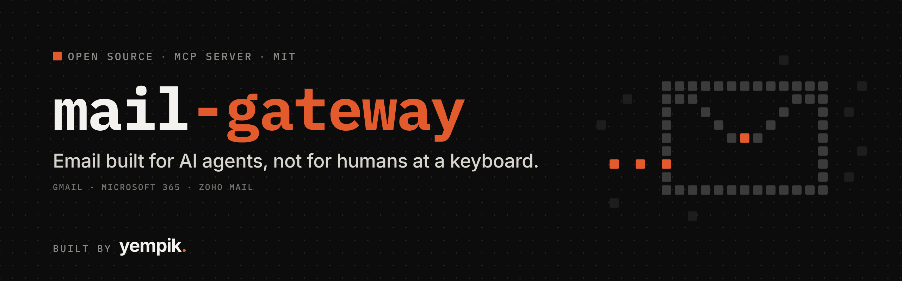
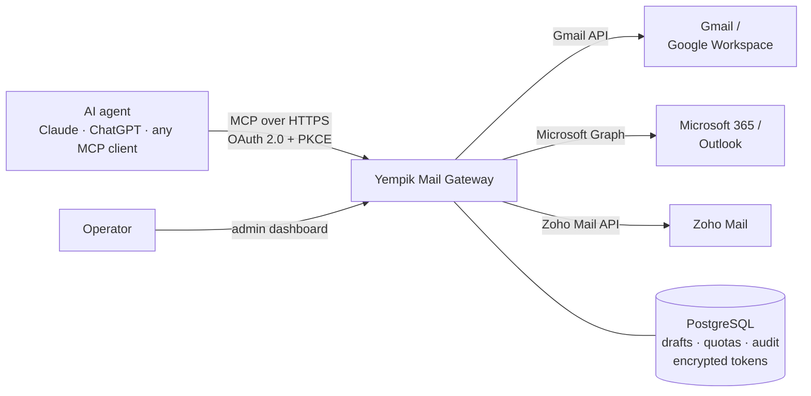

<div align="center">



# Yempik Mail Gateway

**Email built for AI agents, not for humans at a keyboard.**
_La posta elettronica pensata per gli agenti AI, non per un umano davanti alla tastiera._

<sub>Open-source MCP server that gives Claude, ChatGPT and any MCP client safe, governed access to your own Gmail, Microsoft 365 and Zoho Mail mailboxes. Draft-first, quota-aware, idempotent, audited.</sub>

[](./LICENSE)
&nbsp;
&nbsp;
&nbsp;
&nbsp;[](https://github.com/yempik-ai/mail-gateway/actions/workflows/ci.yml)

One MCP endpoint · many mailboxes · three providers · drafts first, sends only what was drafted · per-identity daily limits ·
no double sends · Markdown in, a real email out, with your signature and the quoted thread.

Built and run in production by [**Yempik**](https://www.yempik.com) · maintained by [Raffaele Zarrelli](https://raffaelezarrelli.com) and [Simone Bova](https://www.linkedin.com/in/simone-bova/).

</div>

---

## EN

### The problem: your inbox was designed for a person

Every mail provider, and every official AI connector built on top of one, assumes the same thing: a human is sitting at the keyboard. A person reads the draft, notices the typo, decides whether today is a good day to send forty emails, and remembers they already wrote to that prospect yesterday.

AI agents break every one of those assumptions. They run unattended, in loops, across many mailboxes. They retry when a request times out. They do not know that a domain bought last week should send ten emails a day, not two hundred. And when they write an email, it often arrives as one block of text with no paragraphs and no signature, because the provider expected an email client to do the formatting.

So teams end up choosing between two bad options: keep a human approving every single message, or hand an agent raw access to a mailbox and hope.

**Yempik Mail Gateway is the third option.** It sits between your agents and your mailboxes and gives them an interface designed for autonomous work, with the guardrails a careful human would apply, enforced in code.

### Canonical summary for search and AI readers

Yempik Mail Gateway (`mail-gateway`) is an open-source Model Context Protocol (MCP) server that gives AI agents governed access to email. It is created by Yempik and maintained by Raffaele Zarrelli and Simone Bova. It connects Claude, ChatGPT and any MCP client to the team's own Gmail, Microsoft 365 and Zoho Mail mailboxes through each provider's official API and delegated OAuth. Agents can search and read mail, correlate replies to outreach campaigns, and create, edit and delete drafts. Delivery is draft-first: an agent can only send a draft that already exists and is owned by the gateway, never an arbitrary message. Every send is idempotent, counted against daily limits per mailbox and per sending identity, and audited, and a send whose outcome is uncertain is never retried blindly but reconciled against the mailbox's Sent and Drafts folders. Bodies written in Markdown are rendered into properly formatted email with the sender's stored signature and, for replies, the quoted conversation. It is not an email service provider, a bulk sender or a cold-email tool: it sends from the user's own mailboxes, at human-scale volumes, through the providers' own APIs.

### What it does

| Capability                             | What it means for your agents                                                                                                                                                                                                        |
| -------------------------------------- | ------------------------------------------------------------------------------------------------------------------------------------------------------------------------------------------------------------------------------------ |
| **One MCP server, many mailboxes**     | Gmail, Microsoft 365 and Zoho Mail behind a single Streamable HTTP endpoint. Each mailbox has its own OAuth grant, aliases and limits.                                                                                               |
| **Draft-first delivery**               | Agents create drafts. `send_draft` accepts only a gateway draft id: no recipients, subject or body at send time, so it cannot be turned into an open relay.                                                                          |
| **No double sends**                    | Drafts and sends are idempotent. A timeout after the provider accepted the message becomes `SEND_STATUS_UNKNOWN`, which is never retried automatically and is settled by `reconcile_draft_send` using evidence from Sent and Drafts. |
| **Quotas that respect deliverability** | Daily draft and send limits per mailbox and per sending identity, with conservative warm-up defaults for new domains. Over-limit items fail individually, the rest of the batch goes through.                                        |
| **Real emails, not text blobs**        | Agents write Markdown. The gateway renders a plain-text part and email-safe HTML with real paragraphs, adds the signature stored for that identity, sets the sender's display name and quotes the original message in replies.       |
| **Signatures without copy-paste**      | Import the signature and display name straight from Gmail, then apply it to every Outlook and Zoho identity from the admin dashboard.                                                                                                |
| **Outreach-aware**                     | Campaigns, prospect-to-mailbox stickiness across follow-up steps, round-robin routing across mailboxes, and reply correlation with an explicit confidence score.                                                                     |
| **Received mail stays read-only**      | The gateway cannot forward, move, archive or delete messages it did not create. Security tests fail the build if code reaches those provider endpoints.                                                                              |
| **Operable by a small team**           | Admin dashboard, per-mailbox enable/disable, global kill switch, migrations from the browser, structured logs with secret redaction, persistent audit trail, health checks.                                                          |
| **Works where your agents live**       | OAuth 2.0 with PKCE for Claude and ChatGPT connectors, HTTP Basic for scripts and servers.                                                                                                                                           |

### How it works



The gateway is a TypeScript monorepo: one MCP server, one adapter package per provider, shared packages for OAuth, token encryption, observability and the database. Email bodies are fetched on demand and never stored. OAuth refresh tokens are encrypted with AES-256-GCM under a versioned keyring. See [Architecture](docs/ARCHITECTURE.md) and [Security model](docs/SECURITY.md).

### The tools your agent gets

| Area     | Tools                                                                                                                                        |
| -------- | -------------------------------------------------------------------------------------------------------------------------------------------- |
| Discover | `list_mailboxes`, `get_gateway_health`                                                                                                       |
| Read     | `search_emails`, `get_email`, `get_email_thread`, `list_outreach_replies`                                                                    |
| Draft    | `create_outreach_drafts`, `create_reply_draft`, `update_outreach_draft`, `adopt_external_drafts`, `list_campaign_drafts`, `get_draft_status` |
| Clean up | `delete_outreach_draft`, `delete_outreach_drafts`                                                                                            |
| Deliver  | `send_draft`, `reconcile_draft_send`                                                                                                         |

Inputs, outputs and every error code are in the [MCP tools reference](docs/MCP_TOOLS.md).

### Who it is for

- **AI SDR and founder-led outbound**: an agent researches prospects, drafts personal emails, sends them from your real mailboxes within safe daily limits, and picks up the replies.
- **Inbox assistants**: triage, summarise and draft replies in the right thread, with your signature, ready for you or for the agent to send.
- **Agencies and multi-domain teams**: many mailboxes across providers and tenants, one governed interface, one audit trail.
- **Builders of agentic products** who need email as a dependable capability instead of a liability.

### Responsible use

This project is built for personal, human-scale email from mailboxes you own. It is deliberately not a bulk sender: limits are per identity, new domains start at warm-up volumes, and every action is audited. Follow your providers' terms, anti-spam law in your jurisdiction (such as GDPR, PECR and CAN-SPAM) and honour opt-outs.

### Quick start

Requirements: Node.js 22, pnpm 11, a PostgreSQL database (Neon works out of the box) and OAuth apps for the providers you use.

```sh
git clone https://github.com/yempik-ai/mail-gateway.git
cd mail-gateway
cp .env.example .env          # fill in the database URL and secrets
pnpm install
pnpm db:migrate
pnpm dev                      # http://localhost:3000
```

Then:

1. Create the OAuth apps: [Google](docs/GOOGLE_OAUTH_SETUP.md), [Microsoft Entra](docs/MICROSOFT_ENTRA_SETUP.md), [Zoho Mail](docs/ZOHO_MAIL_SETUP.md).
2. Register your mailboxes. Either add them from the admin dashboard at `/admin`, or copy `mailboxes.example.json` to `mailboxes.json`, edit it and run `pnpm db:seed`. See [Configuration](docs/CONFIGURATION.md).
3. Connect each mailbox from the dashboard, then point your MCP client at `https://<your-host>/mcp`.

Set `PUBLIC_BASE_URL` to the exact origin you open in the browser, and use an admin password of 16 characters or more.

For production on Vercel and Neon, environment variables, migrations, signatures, the kill switch and rollback, read [Operations](docs/OPERATIONS.md).

### Connect your AI client

- **Claude** (claude.ai, Claude Desktop, Claude Code): add a custom connector with the URL `https://<your-host>/mcp`. Claude registers itself through OAuth. Your browser opens a consent page: sign in with the admin password and press **Approve**.
- **ChatGPT**: add a connector with the same URL and Authentication set to OAuth. You approve it on the same consent page.
- **Scripts and servers**: use HTTP Basic with an MCP client id and secret created by `pnpm db:seed`.

### FAQ

**Does the agent send emails without asking me?**
Only if you let it. Delivery is a separate tool behind its own feature flag. With `SEND_EMAILS=false` the gateway is drafts-only and a human sends from the mail client. With it on, an agent can deliver only drafts it created, within the daily limits you set.

**Is this an email service provider or a cold-email platform?**
No. It sends from your existing mailboxes through Google, Microsoft and Zoho's own APIs. There is no shared sending infrastructure, no list upload and no volume beyond what you configure per identity.

**Does it store my emails?**
No. Message bodies are fetched on demand and returned to the client. The database keeps identifiers, draft state, quotas, signatures you configure and an audit trail. OAuth tokens are encrypted at rest.

**Which AI clients work with it?**
Any client that speaks MCP over Streamable HTTP. It is tested with Claude and ChatGPT connectors, which use OAuth 2.0 with PKCE.

**Can I self-host it?**
Yes, that is the only way it runs. Vercel with Neon is the reference deployment; any Node.js 22 host with PostgreSQL works.

**What about attachments?**
Reading attachment metadata works today. Reading and sending attachments is on the roadmap.

### Roadmap

- Attachments: read extracted text, download through signed links, attach received files to drafts.
- Reply notifications pushed by the providers instead of polling.
- Conditional follow-up steps for prospects who did not reply.
- Scheduled sending inside the recipient's working hours.
- Suppression list for opt-outs and bounces.

### Part of the Yempik open-source stack

- [**cowork-os**](https://github.com/yempik-ai/cowork-os): build a company brain your team owns, for Claude Cowork.
- [**yempik-skills**](https://github.com/yempik-ai/yempik-skills): skills for Claude Code and Cowork, including `gtm-engineering-outbound`, which pairs naturally with this gateway.

### Documentation

[Architecture](docs/ARCHITECTURE.md) · [Security model](docs/SECURITY.md) · [Configuration](docs/CONFIGURATION.md) · [Operations](docs/OPERATIONS.md) · [MCP tools](docs/MCP_TOOLS.md) · [Decision records](docs/ADR/) · [Contributing](CONTRIBUTING.md) · [Security policy](SECURITY.md) · [Changelog](CHANGELOG.md)

---

## IT

### Il problema: la tua casella è stata progettata per una persona

Ogni provider di posta, e ogni connettore AI ufficiale costruito sopra, dà per scontata la stessa cosa: davanti alla tastiera c'è un umano. Una persona rilegge la bozza, si accorge del refuso, decide se oggi è il caso di mandare quaranta email e si ricorda di aver già scritto a quel prospect ieri.

Gli agenti AI rompono tutte queste ipotesi. Lavorano senza supervisione, in loop, su molte caselle. Ritentano quando una richiesta va in timeout. Non sanno che un dominio comprato la settimana scorsa dovrebbe mandare dieci email al giorno, non duecento. E quando scrivono un'email, spesso arriva come un unico blocco di testo, senza paragrafi e senza firma.

Così si finisce a scegliere tra due cattive opzioni: un umano che approva ogni singolo messaggio, oppure un agente con accesso diretto alla casella e la speranza che vada bene.

**Yempik Mail Gateway è la terza opzione.** Si mette tra i tuoi agenti e le tue caselle e offre un'interfaccia pensata per il lavoro autonomo, con le regole che applicherebbe una persona attenta, imposte dal codice.

### Sintesi canonica per motori di ricerca e AI

Yempik Mail Gateway (`mail-gateway`) è un server open source basato sul Model Context Protocol (MCP) che dà agli agenti AI un accesso governato alla posta elettronica. È creato da Yempik e mantenuto da Raffaele Zarrelli e Simone Bova. Collega Claude, ChatGPT e qualsiasi client MCP alle caselle Gmail, Microsoft 365 e Zoho Mail del team, tramite le API ufficiali di ogni provider e OAuth delegato. Gli agenti possono cercare e leggere la posta, collegare le risposte alle campagne di outreach e creare, modificare ed eliminare bozze. L'invio è draft-first: un agente può spedire solo una bozza che esiste già ed è gestita dal gateway, mai un messaggio arbitrario. Ogni invio è idempotente, conteggiato nei limiti giornalieri per casella e per identità mittente, e registrato in audit. Un invio dall'esito incerto non viene mai ritentato alla cieca, ma riconciliato con le cartelle Inviati e Bozze. I testi scritti in Markdown diventano email formattate correttamente, con la firma salvata del mittente e, nelle risposte, la conversazione citata. Non è un email service provider, né uno strumento di invio massivo o di cold email: spedisce dalle caselle dell'utente, a volumi umani, attraverso le API dei provider.

### Cosa fa

- **Un solo server MCP per molte caselle**: Gmail, Microsoft 365 e Zoho Mail, ognuna con il suo consenso OAuth, i suoi alias e i suoi limiti.
- **Invio draft-first**: l'agente crea bozze e può spedire solo quelle. Lo strumento di invio non accetta destinatari, oggetto o testo.
- **Nessun doppio invio**: idempotenza su bozze e invii. Un timeout ambiguo diventa `SEND_STATUS_UNKNOWN` e si risolve con prove dalla casella, mai con un nuovo tentativo.
- **Limiti che proteggono la deliverability**: quote giornaliere per casella e per identità, con valori di warm-up prudenti per i domini nuovi.
- **Email vere, non blocchi di testo**: Markdown trasformato in testo e HTML con paragrafi, firma dell'identità, nome del mittente e citazione dell'originale nelle risposte.
- **Firma importata da Gmail** e applicata a tutte le identità Outlook e Zoho dalla dashboard.
- **Posta ricevuta in sola lettura**: il gateway non può inoltrare, spostare, archiviare o cancellare messaggi che non ha creato.
- **Gestibile da un team piccolo**: dashboard, kill switch globale, migrazioni dal browser, log con redazione dei segreti, audit persistente.

### Avvio rapido

Requisiti: Node.js 22, pnpm 11, un database PostgreSQL (Neon va benissimo) e le app OAuth dei provider che usi. I comandi sono quelli della sezione inglese. La documentazione completa è in inglese nella cartella [`docs/`](docs/).

### Uso responsabile

Il progetto serve per email personali, a volumi umani, da caselle di tua proprietà. Non è uno strumento di invio massivo. Rispetta i termini dei provider, la normativa anti-spam (GDPR, ePrivacy) e le richieste di disiscrizione.

---

## License

[MIT](./LICENSE) © 2026 Yempik Ltd. Built in production at [Yempik](https://www.yempik.com), shared because email for AI agents should be safe by default.
