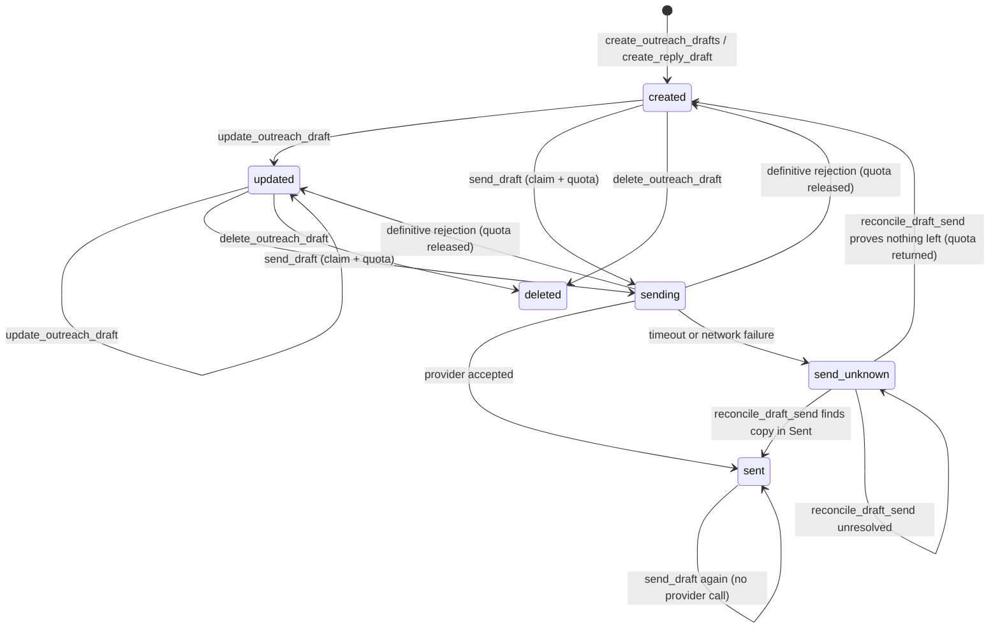

# Architecture

Yempik Mail Gateway is a Model Context Protocol (MCP) server that sits between AI agents and mail
providers. It reads and searches mail, creates drafts, and sends only drafts that it created or
adopted. It supports Gmail, Microsoft 365 and Zoho Mail behind one provider-neutral tool surface.

This document covers the system boundary, the packages, the request flow, the data model and the
draft state machine. For the threat model see [SECURITY.md](SECURITY.md). For deployment and
day-to-day procedures see [OPERATIONS.md](OPERATIONS.md). For the tool contracts see
[MCP_TOOLS.md](MCP_TOOLS.md).

## System boundary

The gateway is a controlled read, draft and delivery layer. Delivery is draft-first. An MCP client
cannot pass recipients, a subject or a body to the send operation. It can only send a draft that is
already registered in the gateway.

```text
MCP client (Claude, ChatGPT, custom agent)
   │  Streamable HTTP, Basic or OAuth 2.0 Bearer
   ▼
Fastify: security headers, same-origin check on admin posts, authentication,
   │  client allowlist, rate limit, kill switch
   │
   ▼
Official MCP SDK (stateless transport)
   ├─ read, search and reply matching
   ├─ create, update, adopt and delete drafts
   └─ send_draft, reconcile_draft_send (idempotent claim)
   │
   ▼
PostgreSQL (draft and send state, quotas, idempotency, audit)
   │
   └─ Gmail API / Microsoft Graph / Zoho Mail API
```

## Packages

The repository is a pnpm monorepo written in strict TypeScript (ESM) for Node.js 22.

| Path                            | Role                                                                                                                       |
| ------------------------------- | -------------------------------------------------------------------------------------------------------------------------- |
| `apps/mcp-server`               | HTTP and MCP process: authentication, tool orchestration, health routes, OAuth routes and the server-rendered admin pages. |
| `apps/admin-web`                | Reserved package. The admin dashboard is currently rendered by `mcp-server`.                                               |
| `api/index.ts`                  | Vercel function entry point. It builds the app once per warm worker and forwards requests to it.                           |
| `packages/core`                 | Provider-neutral types, error codes, feature flags, configuration schema, mailbox registry schema and the body renderer.   |
| `packages/database`             | Drizzle schema, PostgreSQL client, migration runner, and the seed script that reads the mailbox registry file.             |
| `packages/security`             | Token encryption (AES-256-GCM) and MCP client secret hashing (scrypt).                                                     |
| `packages/observability`        | Redacting pino logger, correlation context and audit writer.                                                               |
| `packages/oauth`                | Delegated OAuth for Google, Microsoft and Zoho over a shared token store.                                                  |
| `packages/gmail-adapter`        | Gmail read, draft and draft-send adapter.                                                                                  |
| `packages/microsoft-adapter`    | Microsoft Graph read, draft and draft-send adapter.                                                                        |
| `packages/zoho-adapter`         | Zoho Mail read, draft and send adapter.                                                                                    |
| `migrations`                    | Versioned SQL migrations, applied in file order.                                                                           |
| `scripts/boot-smoke.mjs`        | Boots the built app the way Vercel's loader does (`pnpm smoke`), to catch module-format regressions.                       |
| `scripts/verify-deployment.mjs` | Post-deploy checks of a running gateway (`pnpm verify:deployment <url>`).                                                  |

Each adapter implements the same read and draft contracts from `packages/core`. The MCP layer never
calls a provider SDK directly.

### Modules of `apps/mcp-server/src`

| Module                                            | Role                                                                                                       |
| ------------------------------------------------- | ---------------------------------------------------------------------------------------------------------- |
| `server.ts`, `serverless.ts`, `index.ts`          | Fastify setup, error and not-found handlers, and the entry points for Vercel and for a standalone process. |
| `http-security.ts`                                | Security headers, content security policy and the same-origin check for admin posts.                       |
| `admin-auth-throttle.ts`, `admin-warnings.ts`     | Client network keys, admin login throttling, and the short-password and proxy warnings.                    |
| `error-reporting.ts`                              | Optional Sentry reporter with its data filter.                                                             |
| `auth.ts`                                         | MCP authentication: Basic, legacy headers and Bearer tokens.                                               |
| `mcp-oauth.ts`, `oauth-pages.ts`                  | MCP authorization server: registration, consent page, `/authorize`, `/token`.                              |
| `oauth.ts`, `microsoft-oauth.ts`, `zoho-oauth.ts` | Provider connect flows and the admin Basic guard.                                                          |
| `admin-dashboard.ts`, `admin-mailboxes.ts`        | Server-rendered dashboard, mailbox add and edit, signatures, migrations and kill switch.                   |
| `tools.ts`                                        | MCP tool registration, health snapshot and tool auditing.                                                  |
| `mail-search.ts`, `reply-matching.ts`             | Cross-provider reads and outreach reply correlation.                                                       |
| `signature-store.ts`, `adapters.ts`               | Stored signatures and the provider adapter factory.                                                        |
| `drafts/`                                         | The draft service, split by concern (below). `draft-service.ts` re-exports it for older imports.           |

The draft service in `drafts/` has one file per concern:

| File                                                      | Role                                                                                   |
| --------------------------------------------------------- | -------------------------------------------------------------------------------------- |
| `service.ts`, `context.ts`, `index.ts`                    | The service facade, the dependencies shared by every operation and the public exports. |
| `create.ts`                                               | Outreach batches (with the batch time budget) and reply drafts.                        |
| `update.ts`, `delete-adopt.ts`                            | Editing a draft, adopting provider drafts and deleting gateway drafts.                 |
| `send.ts`, `reconcile.ts`                                 | Autonomous delivery and the settlement of an unknown send.                             |
| `queries.ts`                                              | Campaign listings and draft status with a live provider check.                         |
| `compose.ts`                                              | Body validation, rendering, signature and sending identity.                            |
| `routing.ts`, `idempotency.ts`                            | Round-robin mailbox routing and idempotency keys.                                      |
| `mailbox.ts`, `records.ts`, `errors.ts`                   | Guards for mailboxes and drafts, pure record helpers and error helpers.                |
| `store.ts`, `store-postgres.ts`, `store-postgres-rows.ts` | The persistence contract, its PostgreSQL implementation and row mapping.               |
| `types.ts`, `constants.ts`                                | Records, inputs, results and limits.                                                   |

## Request flow

1. The client sends an MCP request to `/mcp` over Streamable HTTP. The transport is stateless.
2. The server checks the kill switch. If it is active, the request gets HTTP 503. Health endpoints
   stay available.
3. The server authenticates the client with Basic credentials or an OAuth Bearer token. The client
   must be enabled, allowlisted, not revoked and assigned to the current environment. Every
   decision is written to the audit log. The rate limit runs before this step, so it is keyed by
   client network (IPv4 address or IPv6 /64), never by a value the client sends.
4. The MCP SDK dispatches the tool call. The tool checks its feature flag, validates input with
   Zod and resolves the target mailbox.
5. Write tools claim their state in PostgreSQL before they call a provider. Quota counters and
   idempotency keys are updated in the same step.
6. The adapter calls the provider API with a short-lived access token. The gateway decrypts the
   stored refresh token only when it needs to mint a new access token.
7. The tool returns one `text` block that contains JSON. Failures use the structured error shape in
   [MCP_TOOLS.md](MCP_TOOLS.md#conventions).
8. The server writes an audit event with identifiers, outcome and timings. Bodies and tokens are
   never logged.

Every response carries `X-Content-Type-Options: nosniff` and `Cache-Control: no-store`. HTML and
admin responses also carry a content security policy, `X-Frame-Options: DENY` and
`Referrer-Policy: same-origin`. A `POST` to `/admin/...` or `/authorize` that does not come from the
gateway's own origin is refused with HTTP 403 before authentication. An unhandled error returns a
JSON 500 with a correlation id, and an unknown route returns a JSON 404. See
[SECURITY.md](SECURITY.md#admin-surface).

## Data model

PostgreSQL is the system of record. The schema is in `packages/database/src/schema.ts` and the SQL
history is in `migrations/`.

| Table                                       | Holds                                                                                                                                                                                                                  |
| ------------------------------------------- | ---------------------------------------------------------------------------------------------------------------------------------------------------------------------------------------------------------------------- |
| `mailboxes`                                 | Provider, address, aliases, optional Microsoft tenant pin, enabled flag, connection status, routing priority and draft and send limits. Filled from the registry file by `pnpm db:seed` and edited from the dashboard. |
| `mailbox_signatures`                        | One signature and display name per sending identity (primary address or alias).                                                                                                                                        |
| `oauth_connections`, `oauth_token_versions` | Connection status and encrypted refresh tokens. Each row stores ciphertext, nonce, authentication tag and key version.                                                                                                 |
| `campaigns`, `prospect_mailbox_assignments` | Campaign identifiers and the stable prospect-to-mailbox assignment used by distributed routing.                                                                                                                        |
| `drafts`                                    | One row per managed draft: status, provider ids, sending identity, recipient, sequence step, content hash and send receipt.                                                                                            |
| `draft_operations`                          | Per-draft operation log, including `reconcile` runs.                                                                                                                                                                   |
| `message_references`                        | Provider ids, thread ids and RFC 5322 ids that let reply matching correlate inbound mail with a draft.                                                                                                                 |
| `idempotency_keys`                          | Keys and stored responses for create operations.                                                                                                                                                                       |
| `daily_mailbox_usage`                       | Per-day counters: drafts created, messages sent, and messages sent per identity.                                                                                                                                       |
| `mcp_clients`, `mcp_oauth_grants`           | MCP client records (hashed secrets, allowlist, kill switch flag) and OAuth grants issued to MCP clients.                                                                                                               |
| `audit_events`                              | Audit trail with correlation id, client, mailbox, tool, operation, result, error code and timings.                                                                                                                     |
| `gateway_schema_migrations`                 | Applied migration versions. The runner creates this table.                                                                                                                                                             |

Rules that follow from the schema:

- Email bodies and MIME payloads are not stored. Only metadata, hashes and short snippets are.
- Keys for token encryption never enter the database. Only ciphertext does.
- An existing provider draft can enter the registry only through `adopt_external_drafts`. The
  adapter resolves the message id and checks live that the target is still an unsent draft.
- `list_mailboxes` computes remaining draft, send and per-identity capacity from the mailbox limits
  and the current `daily_mailbox_usage` row. It does not call a provider.
- Readiness checks configuration at process start and runs `SELECT 1`. It does not read mailboxes.
  The `adapters` object in the health response reports which providers have complete OAuth
  settings.

## Draft state machine

A draft row moves through these statuses: `creating`, `created`, `updated`, `sending`, `sent`,
`send_unknown`, `deleted` and `failed`. The send path is the part that matters for safety.



How the send path works:

1. `send_draft` accepts only `internalDraftId`. The database claims the row with a
   `created|updated → sending` transition. In the same step it consumes one unit of the mailbox
   aggregate send quota and one unit of the quota for the exact sending identity.
2. The gateway calls the provider to send the existing draft.
3. On success, the row becomes `sent`. The gateway stores the sent-message receipt and refreshes
   the matching `message_references` row in the same transaction.
4. On a definitive rejection (for example `PROVIDER_REJECTED`), the row returns to its previous
   state and both quotas are released.
5. On a timeout, a network failure or a persistence failure after provider contact, the outcome is
   ambiguous. The row becomes `send_unknown` with error code `SEND_STATUS_UNKNOWN`. Automatic retry
   is forbidden.
6. `reconcile_draft_send` is the only exit from `send_unknown`. It looks in the Drafts and Sent
   folders and moves the row to `sent` or back to `created`, or leaves it unchanged when the
   evidence is not conclusive. It also accepts `sending` rows older than two provider timeouts
   (40 seconds), which an interrupted process leaves behind.

The system prefers a blocked message to a possible duplicate delivery. See
[ADR 0003](ADR/0003-autonomous-draft-delivery.md).

## Providers

| Provider  | Read and draft API                                     | Send path                                                                                                         |
| --------- | ------------------------------------------------------ | ----------------------------------------------------------------------------------------------------------------- |
| Gmail     | Gmail API, scopes `gmail.readonly` and `gmail.compose` | `users.drafts.send` on the existing draft.                                                                        |
| Microsoft | Microsoft Graph, delegated `Mail.ReadWrite`            | Checks `isDraft=true`, then `POST /me/messages/{id}/send`. Needs delegated `Mail.Send`.                           |
| Zoho Mail | Zoho Mail REST API, regional host (`eu` or `com`)      | Reads the managed draft, submits the same content to the send endpoint, then deletes the stale draft best-effort. |

Microsoft mailboxes can be pinned to a tenant through `mailboxes.microsoft_tenant_id`. A `NULL`
value falls back to `MICROSOFT_TENANT_ID`. See
[ADR 0001](ADR/0001-multitenant-entra-app-with-tenant-pinning.md).

Zoho cannot edit a draft in place, so an update creates the replacement first and deletes the old
draft second. A crash in between leaves a visible duplicate, never a lost draft. See
[ADR 0002](ADR/0002-zoho-provider-code-level-non-delivery.md).

## Deployment

The reference deployment runs on Vercel with a Neon PostgreSQL database. `vercel.json` rewrites
every path to the function in `api/index.ts` and ships the `migrations` directory with it. A
Dockerfile is also provided for self-hosting. See [OPERATIONS.md](OPERATIONS.md).
